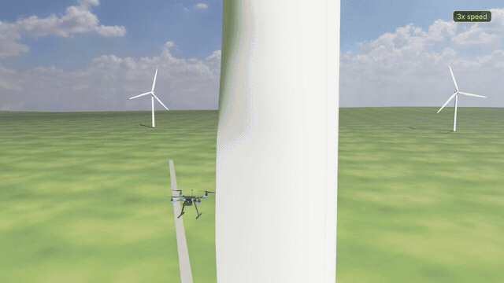
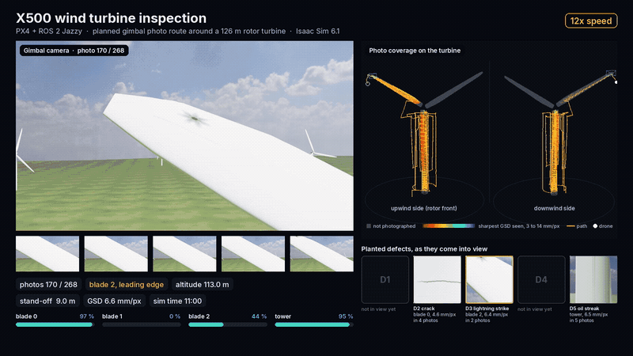

# x500-turbine-inspection

A Holybro X500 quadrotor inspects a wind turbine on its own in NVIDIA Isaac Sim 6.1. It flies a planned route around
the tower and all three blades, takes a gimbal photo at every stop and lands back on the pad. The photos are then
checked for surface coverage and for the five defects planted on the turbine, and fused into a 3D model. PX4 flies
the drone over ROS 2 Jazzy.

<p align="center">
  
</p>
<p align="center">
  
</p>

## Getting started

Tested on Ubuntu 22.04 with an RTX 5070 Ti (16 GB). You need Isaac Sim 6.1 (pip install in a uv environment; set
`ISAAC_PY` if it is not `~/IsaacLab3/.venv/bin/python`) and Docker with the NVIDIA Container Toolkit.

1. Clone the repository and the patched Pegasus Simulator (the PX4 bridge for Isaac Sim):
   ```bash
   git clone https://github.com/prakash-aryan/x500-turbine-inspection.git ~/x500-turbine-inspection
   git clone https://github.com/PegasusSimulator/PegasusSimulator.git ~/PegasusSimulator_isaac61
   cd ~/PegasusSimulator_isaac61 && git checkout bef3c57 && git apply ~/x500-turbine-inspection/patches/pegasus_isaac61.patch
   cd ~/x500-turbine-inspection && uv sync
   ```
2. Build the drone model. `--step` is optional: the Holybro X500 V2 CAD file from the
   [Holybro download page](https://docs.holybro.com/drone-development-kit/px4-development-kit-x500v2/download);
   without it the frame comes from the PX4 meshes.
   ```bash
   git clone --depth 1 https://github.com/PX4/PX4-gazebo-models.git ~/PX4-gazebo-models
   uv run --with "usd-core==25.5.*" --with numpy --with trimesh --with pycollada --with cascadio \
     python scripts/build_x500_usd.py --px4 ~/PX4-gazebo-models --step ~/Downloads/x500v2-frame.step
   ```
3. Build the container with PX4 and RTAB-Map (about 30 minutes):
   ```bash
   docker build -t x500-turbine-inspection:latest docker/
   ```
4. Build the scene and plan the route (a few seconds each). `--hdri` is an optional lat-long sky image:
   ```bash
   uv run python scripts/build_scene.py --out assets/scene --hdri /path/to/sky.hdr
   uv run python scripts/plan_inspection.py --out assets/plan
   ```
5. Start the simulator (terminal 1) and wait for `Waiting for first hearbeat`:
   ```bash
   RUN_DIR=$PWD/runs/f1 VIEWPORT_OFF=1 ./scripts/run_sim.sh
   ```
6. Start PX4 and the mission (terminal 2). The full route is 268 photos and about 19 minutes of simulation time:
   ```bash
   RUN_DIR=$PWD/runs/f1 RANGES="2-337" ./scripts/run_autonomy.sh
   ```
7. Check the photos. This writes `runs/f1/analysis/`: coverage per blade and tower, a crop of each defect and the
   fused 3D model (`model.ply`):
   ```bash
   uv run python scripts/analyze_flight.py runs/f1
   ```

`RANGES` picks waypoints, for example `"2-21,118-189"` for one tower face and blade 0 only.

## How it works

```
Isaac Sim 6.1   turbine scene, X500 with gimbal camera, forward RGB-D camera and lidar, Pegasus  <-- TCP 4560 -->  PX4 SITL
Container       inspection_mission.py   waypoints -> PX4 offboard setpoints, settle, photo request, next waypoint, land
                RTAB-Map                forward RGB-D + PX4 odometry -> 3D map
Analysis        analyze_flight.py       coverage, defects in view, fused 3D model
```

The turbine is built in code with the dimensions of the public NREL 5 MW reference turbine (126 m rotor, 90 m hub).
The planner flies passes around the tower and along each side of every blade at 9 m stand-off with a photo every 4 m.
For shots looking up more than 20 degrees the camera sits on top of the drone, as on inspection drones with an upper
gimbal. Defects are checked by projecting their known positions into the photos; there is no image-based detector.

| Term | Meaning |
|---|---|
| GSD | Ground sample distance: millimetres of surface per pixel. Smaller is sharper. |
| Stand-off | Distance between the drone and the surface it photographs. |
| Coverage | Share of the surface seen in at least one photo, facing the camera and sharp enough. |
| Offboard mode | PX4 mode in which an external program sends the setpoints. |

## Troubleshooting

| Problem | Fix |
|---|---|
| `x500.usda not found` | Run step 2. |
| The drone never arms | Start the simulator first; PX4 connects to it on TCP 4560. |
| `Permission denied` in `runs/` | The container writes some files as root: `sudo chown -R $USER runs`. |
| `ROS2 Bridge startup failed` | `ISAAC_PY` must point at the Isaac Sim 6.1 environment. |

Untested: building the container on a fresh machine, a full flight with the model from `build_x500_usd.py` (it was
only checked to load) and GPUs with less than 16 GB.

## Credits

Turbine dimensions from the NREL 5 MW reference turbine. PX4 Autopilot and the x500 model, Pegasus Simulator and
RTAB-Map (BSD-3-Clause). The Holybro CAD, NVIDIA Isaac Sim and the RealSense model are not redistributed.
